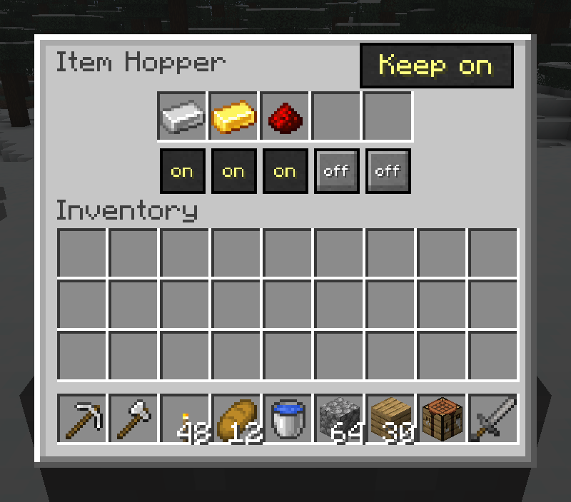

# Hopper Template

A Fabric mod that lets a hopper keep a sample in each slot, and shut the slots it is not using. Between the two, a hopper becomes a five-item filter.

## The two switches

Sneak is not needed: right-click a hopper and its screen has the five slots, a switch under each one, and one more switch for the hopper itself.

- **Keep** - no slot gives up its last item. Whatever is left there stays as a sample of what that slot is for.
- **Off** - that slot takes nothing and gives nothing, by hand or by hopper. It is shown locked, so you cannot put something into a slot that would never give it back.

## Why that makes a filter

A hopper takes an incoming item into a slot already holding that item, or into an empty one. So:

1. Put one of each item you want through - up to five.
2. Turn **Keep** on, so those samples never leave.
3. Switch **off** any slot you are not using.

There are now no empty slots to catch anything else, and every remaining slot already knows what it holds. Anything else offered to the hopper is refused. Nothing new is tracked and no new block is added: it is the hopper's own merge rule, with the two gaps closed.

## Good to know

- A hopper placed before this mod behaves exactly as it did. Nothing is written to a hopper nobody has touched, so a world where this was installed and not used carries no trace of it.
- The settings live on the hopper, so they save, load, and travel with it.
- Feed the filter with more than one of each item if you want it to pass items on. One of an item with **Keep** on is a sample and stays put; the second one through is the one that moves.

## Installing

Server-side, and Pandorical is required on the server. A player needs Pandorical on their client to change the switches; without it they get the vanilla hopper screen, and switches already set keep working.

## Development

Installing is in [DEVELOPMENT.md](DEVELOPMENT.md).

## License

MIT, see [LICENSE](LICENSE).
